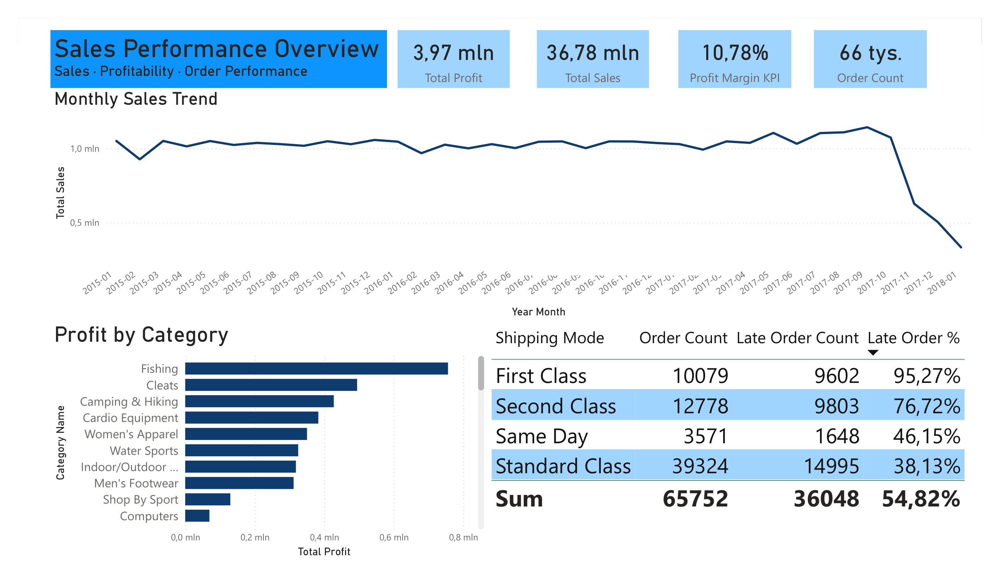
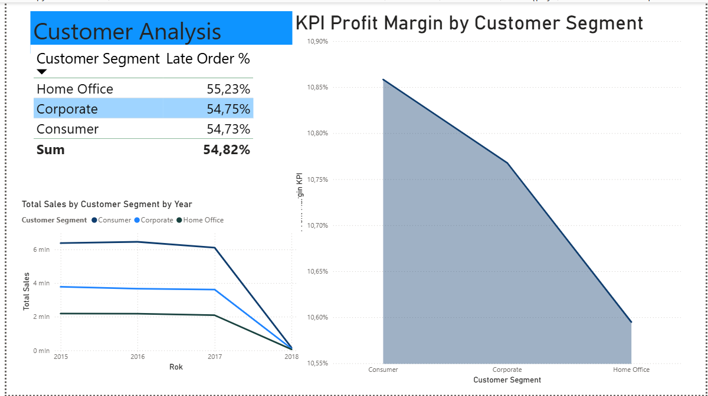
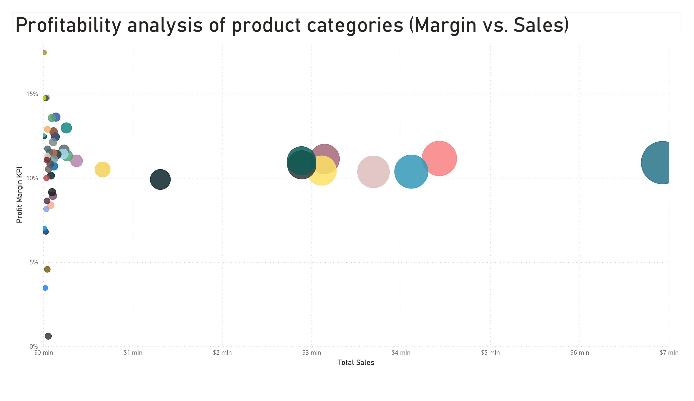
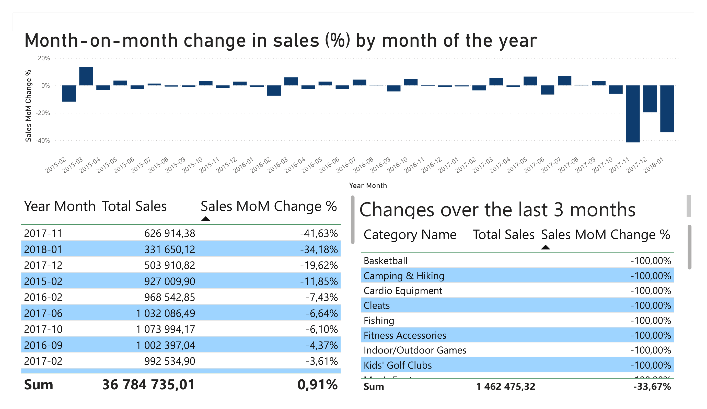

# Power-BI-DataCo-Sales-Analysis

## Project Overview

This project explores sales performance, profitability, customer segments, and delivery outcomes using Power BI. The goal is to demonstrate how transactional data can be transformed into a business-oriented report that supports performance monitoring and exploratory analysis.

## Data Source

This project uses the **DataCo SMART SUPPLY CHAIN FOR BIG DATA ANALYSIS** dataset.

- **Original dataset:** [DataCo Supply Chain Dataset — Mendeley Data](https://data.mendeley.com/datasets/8gx2fvg2k6/5)
- **Dataset on Kaggle:** [DataCo SMART SUPPLY CHAIN FOR BIG DATA ANALYSIS](https://www.kaggle.com/datasets/shashwatwork/dataco-smart-supply-chain-for-big-data-analysis)
- **Main data file:** `DataCoSupplyChainDataset.csv`

The dataset contains structured supply chain data covering sales, product categories, customers, and shipping performance. It also includes supplementary documentation describing the dataset's variables.

This project focuses on the structured transactional data used to analyze sales performance, profitability, customer segments, and delivery outcomes.

## Business Questions

- How do sales and profit change over time?
- Which product categories contribute most to sales?
- How does profitability differ across customer segments?
- How do delivery outcomes vary by shipping method?
- What month-to-month changes can be observed in sales?

## Dashboard Pages

### 1. Executive Overview

A high-level view of sales, profit, profit margin, monthly sales trends, product category performance, and delivery outcomes by shipping method.

Shipping performance varies substantially by shipping method: the reported late-order share ranges from 38.13% for Standard Class to 95.27% for First Class.
Looking at the data from the last three months, we can see a major collapse in the sales trend, with figures dropping to nearly zero.
The categories that generate the most profit are Fishing, Cleats, and Camping & Hiking.

Note: the "profit" category is distinct from the "Profit Margin KPI."

The charts are interactive: selecting a specific category will display all relevant statistics for that category.

### 2. Customer Analysis

A comparison of customer segments in terms of sales, profitability, and delivery outcomes.

Regarding delays across customer segments, there are no significant differences: the Home Office segment has the highest rate of delays (55.23%), while the Consumer segment has the lowest (54.73%)—a gap of less than one percentage point.

Similarly, there are no major differences between customer segments in terms of the Profit Margin KPI. The Consumer segment performs best (approx. 10.85%), while the Home Office segment performs worst (approx. 10.6%); the differences are, therefore, minimal.

Total sales were highest in the Consumer segment and lowest in the Home Office segment. Between 2015 and 2017, the disparities were quite substantial—with the largest segment generating three times the sales of the smallest—excluding 2018, a year marked by a sales collapse, during which sales figures were minimal across all segments.

### 3. Product Category Profitability

An exploratory comparison of product categories by sales and profit margin.

The Golf Bags & Carts category has the best profit margin (17.5%), while "Strength Training" has the lowest (0.6%). It is worth noting that for categories with sales exceeding one million, the profit margin falls within the range of approximately 10–11%.

### 4. Sales Trends

A month-to-month analysis of sales changes over time.

The month-over-month change chart reveals a major collapse in sales over the last three months: January 2018 saw a 34% decline, while November 2017 marked a record drop of 42%.

It is worth noting that this situation is driven by the complete withdrawal of several product categories—such as fishing, cleats, and camping & hiking—which were historically DataCo’s largest sales categories (see slide 3). Interestingly, the last three months have seen significant growth in categories like Video Games, Sporting Goods, Women's Clothing, and Toys, with increases exceeding 100%.

## Tools and Techniques

- **Power BI Desktop** — report development and visualization
- **Power Query** — data preparation and consistency checks
- **DAX** — measures and time-based calculations
- **Data Modeling** — relationships between sales data and supporting dimension tables

## Key Findings

The report examines differences in sales performance across product categories and customer segments, as well as variations in delivery outcomes by shipping method.

The findings should be interpreted in the context of the dataset and the definitions of the underlying measures.

## Files

- `Sales_DataCo_Analysis2026.pbix` — Power BI report
- `Sales_DataCo_Analysis.pdf` - PDF version of report
- `images/` — dashboard screenshots

## Notes

This is a portfolio project created to demonstrate practical business intelligence and data analysis skills. The report is exploratory and should not be interpreted as a representation of any specific company's actual performance.
