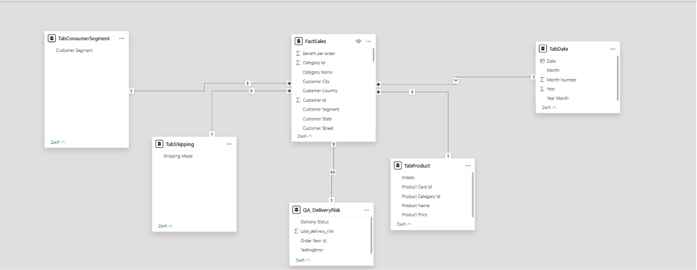

# Power BI — analiza sprzedaży DataCo

## Opis projektu

Projekt analizuje wyniki sprzedaży, rentowność, segmenty klientów oraz terminowość dostaw z wykorzystaniem Power BI. Jego celem jest pokazanie, jak dane transakcyjne można przekształcić w raport biznesowy wspierający monitorowanie wyników i analizę eksploracyjną.

## Źródło danych

Projekt wykorzystuje zbiór danych **DataCo SMART SUPPLY CHAIN FOR BIG DATA ANALYSIS**.

- **Oryginalny zbiór danych:** [DataCo Supply Chain Dataset — Mendeley Data](https://data.mendeley.com/datasets/8gx2fvg2k6/5)
- **Zbiór danych na Kaggle:** [DataCo SMART SUPPLY CHAIN FOR BIG DATA ANALYSIS](https://www.kaggle.com/datasets/shashwatwork/dataco-smart-supply-chain-for-big-data-analysis)
- **Główny plik danych:** `DataCoSupplyChainDataset.csv`

Zbiór zawiera dane dotyczące łańcucha dostaw, w tym sprzedaży, kategorii produktów, klientów i realizacji dostaw. Obejmuje również dokumentację opisującą poszczególne zmienne.

Projekt koncentruje się na analizie danych transakcyjnych w celu oceny sprzedaży, rentowności, segmentów klientów i wyników dostaw.

## Pytania biznesowe

- Jak zmieniają się sprzedaż i zysk w czasie?
- Które kategorie produktów generują największą sprzedaż?
- Jak rentowność różni się między segmentami klientów?
- Jak wyniki dostaw różnią się w zależności od metody wysyłki?
- Jakie zmiany sprzedaży można zaobserwować z miesiąca na miesiąc?

## Strony raportu

### 1. Executive Overview

Ogólny obraz sprzedaży, zysku, marży, miesięcznych trendów sprzedaży, wyników kategorii produktów oraz dostaw według metod wysyłki.


Terminowość dostaw znacznie różni się w zależności od metody wysyłki. Udział opóźnionych zamówień wynosi od 38,13% dla Standard Class do 95,27% dla First Class.

Analiza ostatnich trzech miesięcy pokazuje gwałtowny spadek sprzedaży — jej poziom obniżył się o około 70%.

Największy zysk generują kategorie Fishing, Cleats oraz Camping & Hiking.

**Uwaga:** zysk (*Profit*) i wskaźnik marży zysku (*Profit Margin KPI*) to dwie różne miary.

Wykresy są interaktywne — wybór konkretnej kategorii pozwala wyświetlić dotyczące jej statystyki.

### 2. Customer Analysis

Porównanie segmentów klientów pod względem sprzedaży, rentowności i wyników dostaw.


Odsetek opóźnionych zamówień jest zbliżony we wszystkich segmentach klientów. Najwyższy występuje w segmencie Home Office (55,23%), a najniższy w Consumer (54,73%). Różnica wynosi mniej niż jeden punkt procentowy.

Podobnie niewielkie różnice występują w marży zysku. Najwyższą wartość odnotowano w segmencie Consumer (około 10,85%), a najniższą w Home Office (około 10,6%).

Największą sprzedaż generuje segment Consumer, a najmniejszą Home Office. W latach 2015–2017 różnice były znaczące — sprzedaż w największym segmencie była około trzykrotnie wyższa niż w najmniejszym. W 2018 roku, dla którego dane kończą się w styczniu, sprzedaż we wszystkich segmentach była znacznie niższa.

### 3. Product Category Profitability

Eksploracyjne porównanie kategorii produktów pod względem sprzedaży i marży zysku.


Kategoria Golf Bags & Carts osiąga najwyższą marżę zysku (17,5%), natomiast najniższą odnotowano w kategorii Strength Training (0,6%).

W kategoriach, których sprzedaż przekracza milion, marża zysku mieści się zazwyczaj w przedziale około 10–11%.

### 4. Sales Trends

Analiza zmian sprzedaży z miesiąca na miesiąc.


Wykres zmian miesięcznych pokazuje gwałtowny spadek sprzedaży w końcowym okresie zbioru danych. W styczniu 2018 roku sprzedaż spadła o 34%, a w listopadzie 2017 roku odnotowano jeszcze większy spadek — o 42%.

Zjawisku temu towarzyszy brak zarejestrowanej sprzedaży w ostatnich trzech miesiącach w kilku kategoriach, które wcześniej należały do największych pod względem sprzedaży: Fishing, Cleats oraz Camping & Hiking. Dane nie pozwalają jednak ustalić, czy wynika to ze zmiany biznesowej, czy z niekompletności okresu sprawozdawczego.

Jednocześnie w ostatnich trzech miesiącach odnotowano wzrosty przekraczające 100% w kategoriach takich jak Video Games, Sporting Goods, Women's Clothing oraz Toys.

## Implementacja techniczna

### 1. Przygotowanie danych — Power Query

- Usunięto zbędne kolumny, w tym adresy e-mail, hasła i imiona oraz nazwiska klientów, a także nieużywane pola dotyczące produktów.
- Sprawdzono kompletność danych i usunięto kolumnę ZIP code, w której około 97% wartości było pustych.
- Ujednolicono nazwy krajów, typy danych, formaty liczbowe i daty.
- Dodano kolumnę indeksu wspierającą przygotowanie danych.
- Sprawdzono rozkłady wartości w kolumnach i potwierdzono unikatowość `Order Item Id`.
- Zweryfikowano zgodność `Late_delivery_risk` i `Delivery Status` za pomocą własnej reguły logicznej w Power Query. W sprawdzonych rekordach nie wykryto niezgodności.

### 2. Modelowanie danych

- Zorganizowano dane w centralnej tabeli faktów sprzedażowych (`FactSales`) oraz tabelach wymiarów dotyczących produktów, segmentów klientów, metod wysyłki i dat.
- Utworzono relacje jeden-do-wielu między tabelą faktów a tabelami wymiarów, z jednokierunkowym filtrowaniem od wymiarów do faktów.
- Dla relacji między `FactSales` i `QA DeliveryRisk` utworzono relację jeden-do-jednego z dwukierunkowym filtrowaniem.
- Utworzono tabelę kalendarza w DAX, zawierającą rok, numer miesiąca, nazwę miesiąca i atrybut rok-miesiąc.
- Wykorzystano osobną kolumnę daty do analizy zmian w czasie.

**Model danych:**



### 3. Miary DAX

Raport wykorzystuje miary DAX do obliczania kluczowych wskaźników biznesowych i analizy zmian w czasie.

**Total Sales** — całkowita wartość sprzedaży.

```dax
Total Sales =
SUM(FactSales[Sales])
```

**Total Profit** — całkowity zysk, obliczany na podstawie wybranego pola zysku i po weryfikacji poziomu szczegółowości danych.

```dax
Total Profit =
SUM(FactSales[Order Profit Per Order])
```

**Profit Margin %** — marża zysku, obliczana jako stosunek zysku do sprzedaży.

```dax
Profit Margin % =
DIVIDE(
    [Total Profit],
    [Total Sales]
)
```

**Order Count** — liczba unikatowych zamówień.

```dax
Order Count =
DISTINCTCOUNT(FactSales[Order ID])
```

**Units Sold** — łączna liczba sprzedanych sztuk.

```dax
Units Sold =
SUM(FactSales[Order Item Quantity])
```

**Sales Previous Month** — sprzedaż w poprzednim miesiącu, obliczana przy użyciu `CALCULATE` i `DATEADD`.

```dax
Sales Previous Month =
CALCULATE(
    [Total Sales],
    DATEADD(TabDate[Date], -1, MONTH)
)
```

**Sales MoM Change** — bezwzględna zmiana sprzedaży względem poprzedniego miesiąca.

```dax
Sales MoM Change =
[Total Sales] - [Sales Previous Month]
```

**Sales MoM Change %** — procentowa zmiana sprzedaży względem poprzedniego miesiąca.

```dax
Sales MoM Change % =
DIVIDE(
    [Sales MoM Change],
    [Sales Previous Month]
)
```

**Sales YTD** — skumulowana sprzedaż od początku roku do analizowanej daty, obliczana przy użyciu `TOTALYTD`.

```dax
Sales YTD =
TOTALYTD(
    [Total Sales],
    TabDate[Date]
)
```

Miary umożliwiają dynamiczną analizę danych według dat, kategorii produktów, segmentów klientów i metod wysyłki.

### 4. Projekt raportu i analiza biznesowa

Raport Power BI składa się z czterech stron:

- **Executive Overview** — kluczowe wskaźniki, trendy sprzedaży, rentowność i wyniki dostaw.
- **Customer Analysis** — porównanie sprzedaży, marży zysku i odsetka opóźnionych zamówień w segmentach klientów.
- **Product Category Profitability** — porównanie kategorii produktów pod względem sprzedaży, zysku i marży zysku.
- **Sales Trends** — analiza miesięcznych zmian sprzedaży i wzorców na poziomie kategorii.

Interaktywne wykresy i segmentatory pozwalają analizować wyniki dla różnych okresów, kategorii produktów i metod wysyłki.

### 5. Jakość danych i ograniczenia

- Sprawdzono zgodność flag ryzyka opóźnienia ze statusami dostaw.
- Zbadano unikatowość identyfikatorów i występowanie brakujących wartości podczas przygotowania danych.
- Przeanalizowano spadki sprzedaży i zmiany na poziomie kategorii, unikając przypisywania im przyczyn, których nie można potwierdzić na podstawie danych.
- Zidentyfikowano gwałtowny spadek sprzedaży w końcowych miesiącach zbioru. Ustalenie, czy odzwierciedla on rzeczywiste zmiany biznesowe, czy niekompletność okresu sprawozdawczego, wymaga dalszej weryfikacji.

## Narzędzia i techniki

- **Power BI Desktop** — tworzenie raportu i wizualizacja danych.
- **Power Query** — przygotowanie danych i kontrola ich spójności.
- **DAX** — miary i obliczenia w analizie czasowej.
- **Modelowanie danych** — relacje między danymi sprzedażowymi a tabelami wymiarów.

## Pliki

- `Sales_DataCo_Analysis2026.pbix` — raport Power BI.
- `Sales_DataCo_Analysis2026.pdf` — wersja raportu w formacie PDF.
- `images/` — zrzuty ekranu dashboardów i modelu danych.

## Uwagi

Projekt portfolio został przygotowany w celu zaprezentowania praktycznych umiejętności z zakresu analizy danych i Business Intelligence. Ma charakter eksploracyjny i nie przedstawia rzeczywistych wyników żadnej konkretnej firmy.
